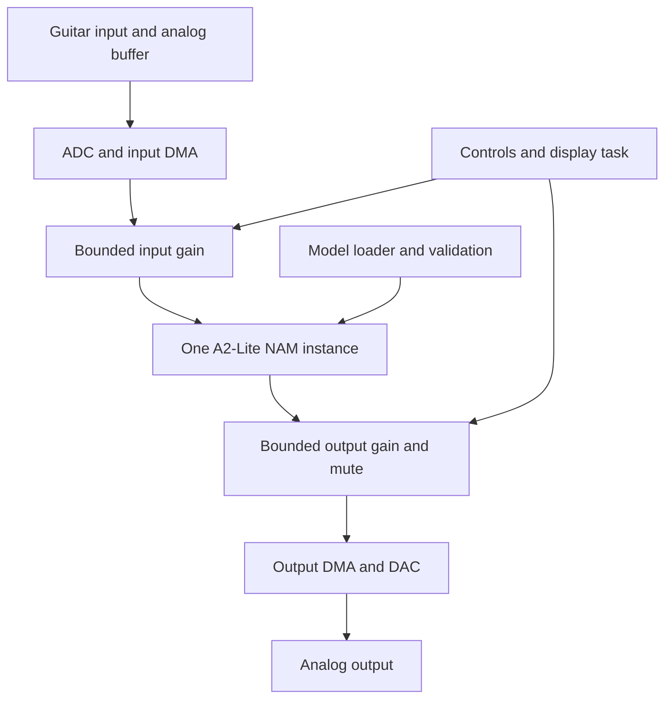

# Proposed architecture

This is a design proposal. Peripheral names describe responsibilities, not verified Blackbox connections.

## Firmware responsibilities

| Part | Work | First version |
| --- | --- | --- |
| Board support | Clocks, memory, interrupt setup, verified GPIO and power | Minimum required for audio and recovery |
| Audio driver | Verified ADC/DAC path, format conversion, DMA ownership and overruns | Mono passthrough first |
| NAM adapter | Checked block lengths, model state, gains, numerical behavior | One supported A2-Lite shape |
| Model storage | Bounds, length, CRC, configuration and sample-rate checks | One capture, initially fixed storage |
| Control task | Footswitch, mute, gains and later presets | No unbounded work in audio callback |
| Display | Minimal status and later model selection | Optional until continuous audio works |
| Update/recovery | Validated boot path and image layout | Preserve established recovery behavior |

The audio callback must avoid file I/O, dynamic allocation, blocking synchronization, rendering and model parsing. A separate task prepares changes. Publish parameter changes through bounded transfers. Do not mutate active model state while it is processing.

## Desktop preparation

Download an explicitly compatible capture from TONE3000; record its provenance and allowed use; export the supported model where necessary; convert it with a pinned `nam2namb`; validate by rendering against NAM; then transfer the checked file using a separately documented transport.

The initial pedal need not connect to TONE3000 itself. Its API is a later desktop-editor integration option. Do not publish API keys or authenticated download URLs.

## Stock firmware relationship

The intended result replaces proprietary inference. A minimal standalone firmware avoids depending on undocumented proprietary function calls. Reusing existing drivers through binary hooks is an alternative research experiment, not an established stable API. Record the exact image hash, calling convention, memory ownership and interrupt constraints for any such experiment.

Keep original effects and model formats out of the first acceptance requirement. Their eventual retention or replacement needs separate engineering decisions.
