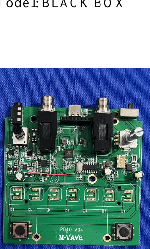
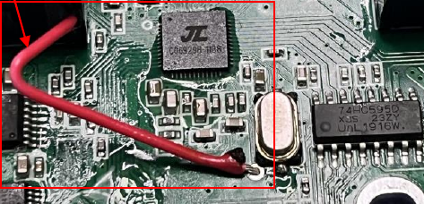
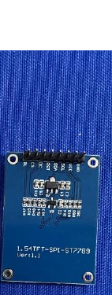

# Photograph guide

Source: **Sinco Intelligent Technology Co., Ltd., FCC internal-photo exhibit 7467092**, filed 2024-07-11 under `2ARCP-BLACK-BOX`. Five pages; the retrieved PDF's SHA-256 is `f1779277680549124da59de20a534594ee7559f49b43a94aea681a97cba66386`.

These are limited detail excerpts for the [component analysis](../../docs/03-hardware-inventory.md), extracted from a PDF rendering at a 1,800-pixel maximum page dimension. They are source photographs, not generated teardown images. The full exhibit is linked below.

## Board identification, page 2

The `PD40 V04` label identifies the photographed board. The two footswitches and jack/control region establish orientation. This picture does not identify the processor variant or flash geometry.

## Processor, logic IC and antenna, page 3

The central square IC carries JieLi branding. The IC beside the crystal is marked `74HC595D`. The exhibit labels the red wire BT/BLE antenna. The main IC's full model code remains insufficiently clear for a reliable variant assignment.

## Display-board label, page 4

The label reads `1.54TFT-SPI-ST7789`, `Ver:1.1`. It is a useful driver-family lead; verify controller suffix, initialization and Blackbox pin routing independently.

## Complete source exhibits

| Exhibit | Links | Verification |
| --- | --- | --- |
| 2024 internal photos, 7467092 | [Catalog](https://fccid.io/2ARCP-BLACKBOX/Internal-Photos/Internal-photos-7467092), [PDF](https://fccid.io/2ARCP-BLACK-BOX/Internal-Photos/Internal-photos-7467092.pdf), [mirror](https://device.report/m/f1779277680549124da59de20a534594ee7559f49b43a94aea681a97cba66386.pdf), [FCC attachment](https://apps.fcc.gov/eas/GetApplicationAttachment.html?id=7467092) | Retrieved and visually inspected |
| 2025 internal photos, 8052662 | [Catalog](https://fccid.io/2ARCP-BLACKBOX/Internal-Photos/Internal-Photo-8052662), [mirror PDF](https://device.report/m/92b7148405d54baa367da5aa8d161a635d4235d3af740ef9c113a30f3403d919.pdf), [FCC attachment](https://apps.fcc.gov/eas/GetApplicationAttachment.html?id=8052662) | Catalog checked; bytes not compared |

The 2025 catalog gives SHA-256 `92b7148405d54baa367da5aa8d161a635d4235d3af740ef9c113a30f3403d919`; this is catalog metadata, not a locally verified hash.

Public filing access does not establish a complete BOM or an open photograph license. See [THIRD_PARTY.md](../../THIRD_PARTY.md). For future owner-supplied photographs, record a reuse license and retain original resolution.
